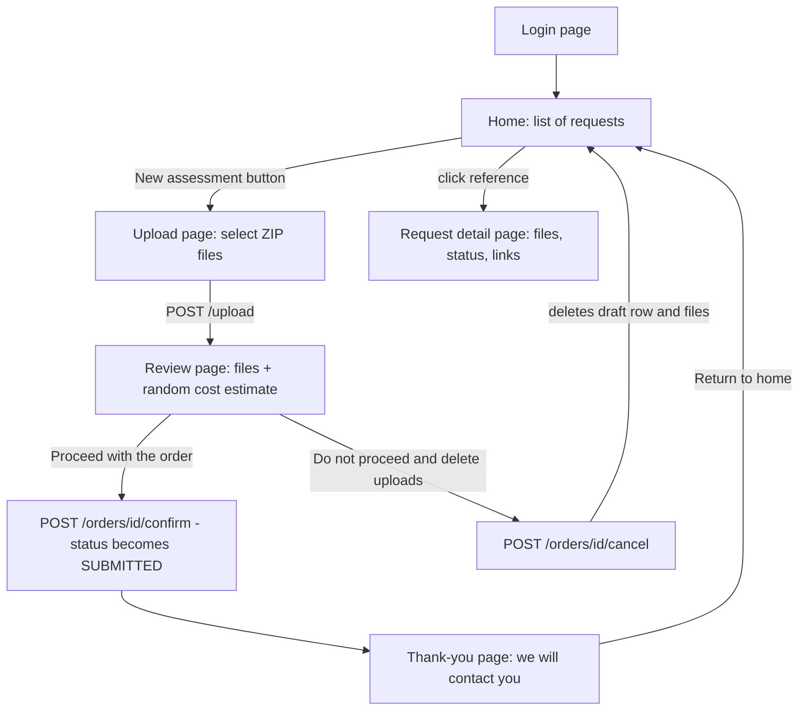
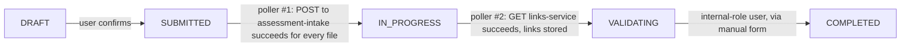
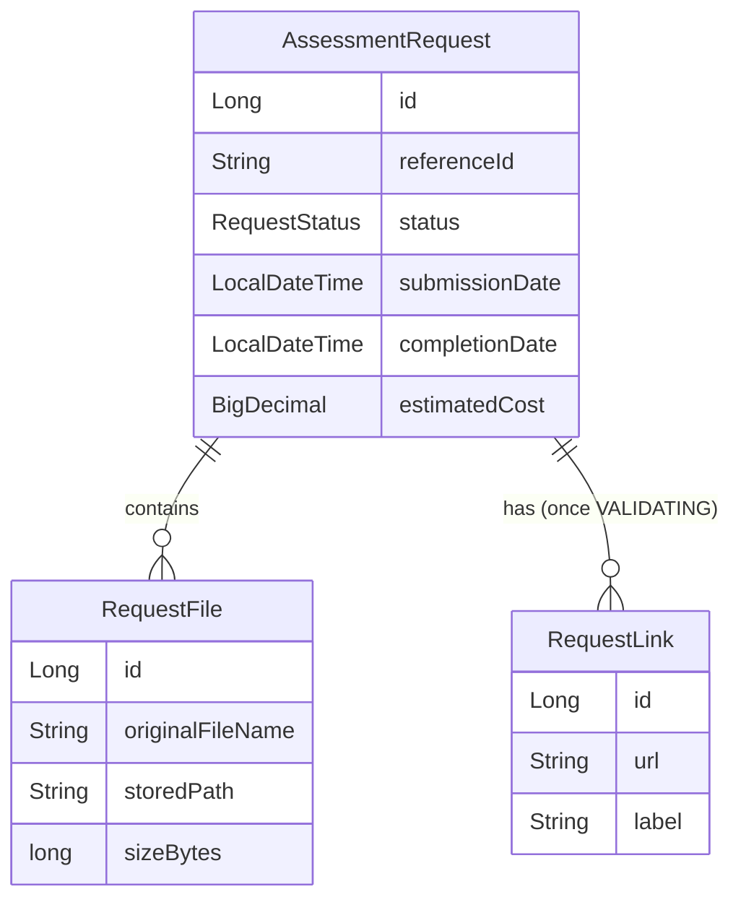

# SecureScope AI &mdash; Vulnerability Assessment Cost Estimator (Mockup)

A Quarkus web application that lets a user upload one or more ZIP files
(Java, Python, or JavaScript projects), instantly receive a **mockup,
randomly generated** cost estimate for a future code vulnerability
assessment, and then tracks that request through a full lifecycle
(`Submitted &rarr; In Progress &rarr; Validating &rarr; Completed`) driven by
two configurable external integrations and a manual, role-restricted
override. The application runs **fully offline**: every static asset
(CSS/JS/fonts/icons) is served by the app itself, with no CDN calls at
runtime.

---

## Table of contents

1. [Scope](#scope)
2. [User flow](#user-flow)
3. [Request lifecycle](#request-lifecycle)
4. [Roles &amp; users](#roles--users)
5. [Screens](#screens)
6. [Technical overview](#technical-overview)
7. [External integrations](#external-integrations)
8. [Project structure](#project-structure)
9. [Data model](#data-model)
10. [Authentication &amp; authorization](#authentication--authorization)
11. [Offline / disconnected operation](#offline--disconnected-operation)
12. [Configuration reference](#configuration-reference)
13. [Running the application](#running-the-application)
14. [Containers (Dockerfile &amp; Podman)](#containers-dockerfile--podman)
15. [Kubernetes / OpenShift deployment](#kubernetes--openshift-deployment)
16. [Known limitations / mockup shortcuts](#known-limitations--mockup-shortcuts)
17. [Possible next steps](#possible-next-steps)

---

## Scope

This is **intentionally a mockup**, not a production system. It exists to:

- Let a user submit ZIP archives of a codebase (Java, Python, JavaScript) for
  a future vulnerability assessment.
- Show a **history list** of past submissions with their status and, once
  available, links to results.
- Produce a **randomized** cost estimate in real time, standing in for
  pricing logic that will eventually be computed by dedicated tooling.
- Provide a two-step **upload &rarr; review &rarr; confirm/cancel** flow so a
  user can back out and delete their upload before anything is recorded.
- Demonstrate a realistic **asynchronous processing pipeline**: two
  configurable REST integrations (an intake POST and a results GET) move a
  confirmed request through its lifecycle via background polling, with the
  final `Completed` step gated behind a manual, internal-role-only action.
- Run in a **disconnected / offline** environment: all UI assets are
  self-hosted, no internet access is required to use the app (the two
  external REST integrations are the only network calls the app makes on
  purpose, and they gracefully retry if unreachable).

What it explicitly does **not** do:

- No real static/dynamic vulnerability scanning of the uploaded code.
- No real pricing engine &mdash; the estimate is a randomized, plausible-looking
  number (see [Cost estimation](#cost-estimation)).
- No production-grade identity provider, multi-tenancy, or user
  self-registration.
- No outbound notification (e-mail/Slack/etc.) when an order is confirmed;
  the "we'll contact you" message is illustrative only.

---

## User flow



Step by step:

1. **Login** (`/login`): the user authenticates with one of the hardcoded
   demo accounts. This is a fake login for the mockup &mdash; see
   [Roles & users](#roles--users).
2. **Home** (`/`): lists every request that has been confirmed so far
   (identifier, uploaded file names, submission date, completion date,
   status). Includes seed/demo data on first run so the page never looks
   empty. Clicking a reference id opens its detail page.
3. **Upload** (`/upload`): the user selects one or more `.zip` files via a
   drag-and-drop zone (or the classic file picker) and submits them in a
   single multipart request.
4. **Review** (`/orders/{id}/review`): as soon as the files are uploaded,
   the server stores them, computes a random cost estimate, and shows a
   review page with the file list, the estimate, and two action buttons.
5. From the review page, the user picks one of:
   - **"Proceed with the order"** &rarr; the request's status becomes
     `SUBMITTED` and it becomes visible on the home page. The user lands on
     a **thank-you page** confirming they'll be contacted, with a button
     back to Home.
   - **"Do not proceed and delete uploads"** &rarr; the uploaded files and
     the draft request are deleted immediately; the user is sent back to
     Home and **no new entry appears** in the list.
6. **Detail page** (`/orders/{id}`): shows the full request &mdash; files,
   status, dates, cost, and any **result links** once available. If the
   logged-in user has the `internal` role, a **manual status-change form**
   also appears here (see [Roles & users](#roles--users) and
   [Request lifecycle](#request-lifecycle)).

---

## Request lifecycle

Beyond the initial `SUBMITTED` transition (set explicitly when the user
clicks "Proceed with the order"), the rest of the lifecycle is driven by
two independent background pollers plus one manual, role-gated action:



- **`DRAFT` &rarr; `SUBMITTED`**: set synchronously when the user clicks
  "Proceed with the order" (`OrderResource.confirm`).
- **`SUBMITTED` &rarr; `IN_PROGRESS`**: a background poller
  (`PollingService.pollSubmittedRequests`, interval configurable via
  `app.polling.submitted-interval`) finds every `SUBMITTED` request and, for
  *each of its uploaded files*, sends one `POST {referenceId, file}` to the
  configurable **assessment-intake** REST client. Only once *every* file of
  a request was sent successfully does that request move to `IN_PROGRESS`;
  any failure (service down, non-2xx response, etc.) simply leaves it as
  `SUBMITTED` to be retried on the next poll.
- **`IN_PROGRESS` &rarr; `VALIDATING`**: a second background poller
  (`PollingService.pollInProgressRequests`, interval configurable via
  `app.polling.in-progress-interval-seconds`, expressed in seconds) finds
  every `IN_PROGRESS` request and sends a `GET` to the configurable
  **links-service** with `referenceId` as a query parameter. On success, the
  returned links are persisted and made visible on the request's detail
  page, and the request moves to `VALIDATING`. On failure, it stays
  `IN_PROGRESS` and is retried on the next poll.
- **`VALIDATING` &rarr; `COMPLETED`**: **only** reachable through the manual
  status-change form on the request detail page, and **only** by a user with
  the `internal` role. The background pollers never set `COMPLETED`
  themselves. In fact, the manual form lets an `internal` user set *any*
  status on *any* request (simple dropdown) &mdash; it isn't restricted to
  forward-only transitions &mdash; but it is the **only** path to
  `COMPLETED`.

---

## Roles & users

Two hardcoded demo accounts exist (see [Authentication & authorization](#authentication--authorization)):

| Username | Password | Roles | Can do |
| --- | --- | --- | --- |
| `demo` | `demo123` | `user`, `customer` | Everything a regular end user does: log in, upload, review, confirm/cancel, view the home list and request details (including links, once available). |
| `internal` | `internal123` | `internal` | Everything `demo` can do, **plus** the manual status-change form on the request detail page (the only way to reach `COMPLETED`). |

Authorization is enforced with `@RolesAllowed("internal")` on the
status-change endpoint
([`OrderResource.changeStatus`](src/main/java/com/redhat/mockup/vulnassess/web/OrderResource.java)),
and the form itself is only rendered in the detail-page template when the
current `SecurityIdentity` has the `internal` role.

---

## Screens

| Screen | Route | Purpose |
| --- | --- | --- |
| Login | `GET /login` | Fake login form (form-based auth) |
| Home | `GET /` | History list of confirmed requests |
| Upload | `GET /upload` / `POST /upload` | Multi-ZIP upload form |
| Review | `GET /orders/{id}/review` | Shows estimate + Proceed/Cancel buttons |
| Confirm | `POST /orders/{id}/confirm` | Sets status to `SUBMITTED`, redirects to thank-you |
| Thank-you | `GET /orders/{id}/thank-you` | "We'll contact you" confirmation page |
| Cancel | `POST /orders/{id}/cancel` | Deletes the draft + uploaded files |
| Detail | `GET /orders/{id}` | Files, status, links; manual status form for `internal` role |
| Change status | `POST /orders/{id}/status` | `internal` role only |
| Logout | `GET /logout` | Clears the session cookie |

All pages share a common Bootstrap 5 + Bootstrap Icons look and feel
(gradient hero, card-based layout, status badges, animated CTA buttons) via
the shared [`base.html`](src/main/resources/templates/base.html) Qute
layout and [`app.css`](src/main/resources/META-INF/resources/css/app.css).

---

## Technical overview

| Concern | Choice |
| --- | --- |
| Framework | [Quarkus](https://quarkus.io) `3.33.3` (see [version note](#version-note)) |
| Language / runtime | Java 21 |
| Build tool | Maven |
| Web layer | `quarkus-rest` (Jakarta REST / RESTEasy Reactive) |
| Server-side rendering | `quarkus-qute` + `quarkus-rest-qute` |
| Persistence | `quarkus-hibernate-orm-panache` + `quarkus-jdbc-h2` (file-based H2 DB) |
| Authentication | `quarkus-elytron-security-properties-file` (embedded users) + Quarkus form auth |
| Authorization | `@RolesAllowed` (Quarkus Security) on the internal-only endpoint |
| Background jobs | `quarkus-scheduler` (two config-driven pollers) |
| Outbound REST clients | `quarkus-rest-client` + `quarkus-rest-client-jackson` |
| Front-end assets | **Self-hosted** Bootstrap 5 + Bootstrap Icons via WebJars (Maven Central), system font stack, small vanilla JS &mdash; **no CDN, no SPA / JS build step** |

### Version note

The project currently targets the plain community
release **`3.33.3`** from Maven Central 
(`quarkus.platform.version` in [`pom.xml`](pom.xml)).

To switch to the Red Hat productized build later, update `quarkus.platform.version` in `pom.xml` to the desired
   `*-redhat-*` version. (`3.33.3.SP2-redhat-00001`)

### Why server-rendered Qute instead of a SPA

The app deliberately avoids a separate JavaScript build pipeline (React,
Vite, etc.). Every page is rendered server-side with
[Qute](https://quarkus.io/guides/qute) templates, returned directly from
JAX-RS resource methods via `@CheckedTemplate`. This keeps the mockup
simple to build, run, and hand off, while still allowing a modern look via
Bootstrap 5 and a small amount of hand-written CSS/JS
(drag-and-drop styling, client-side `.zip` filtering &mdash; purely
progressive enhancement, the server always re-validates).

### Cost estimation

Implemented in
[`CostEstimationService`](src/main/java/com/redhat/mockup/vulnassess/service/CostEstimationService.java).
The "estimate" is **not** a real pricing model: it combines a base cost, a
per-file cost, a size-based cost, and a randomized &plusmn;20% jitter
factor, so that:

- Repeated demos with the same files don't always show an identical number.
- The number still *looks* plausible relative to how many/how large the
  uploaded files are.

This is explicitly a placeholder to be replaced once real assessment
tooling exists and can provide actual pricing signals.

### Demo seed data

On startup, if the database is empty,
[`AssessmentRequestService`](src/main/java/com/redhat/mockup/vulnassess/service/AssessmentRequestService.java)
seeds a few historical requests so the home page isn't empty on first run:
two `COMPLETED` examples, and one `VALIDATING` example with two
pre-populated sample links (so the links UI has something to show without
needing the external service). **`SUBMITTED`/`IN_PROGRESS` are deliberately
not seeded**: those states are meant to be driven by the real upload flow
plus the background pollers, and seeded rows don't have real files on disk
for the intake poller to send.

---

## External integrations

Both lifecycle-driving background pollers (see
[Request lifecycle](#request-lifecycle)) talk to a single real external
service: **ai-scanner**, the actual AI-driven code vulnerability scanner
this mockup estimates the cost for. The contract below was confirmed
directly against that project's source
(`src/scans/scans.controller.ts`, `src/auth/bearer.guard.ts`) and verified
live against a local instance at `http://localhost:3000`.

One client, [`AiScannerClient`](src/main/java/com/redhat/mockup/vulnassess/client/AiScannerClient.java),
is used by both pollers:

### 1. Start a scan (`POST /api/scan/{id}`)

- **Called by**: `PollingService.pollSubmittedRequests`, once per
  `SUBMITTED` request.
- **`{id}`**: our own `referenceId`, **lower-cased** &mdash; the real
  service requires scan ids to match `^[a-z0-9-]{1,64}$` (lowercase
  letters, digits, dashes only), while our `referenceId` is uppercase
  (`VA-A1B2C3D4`) for human-friendly display. The lower-casing is
  deterministic, so the same id is used to start and later poll the scan.
- **Body** (`multipart/form-data`): `profile` (required &mdash; configurable
  via `app.ai-scanner.profile`, defaults to `security`) and `file`, the
  source archive. The real API accepts exactly **one** archive per scan:
  if the request has a single uploaded file it is sent as-is; if it has
  several, [`FileStorageService.prepareScanArchive`](src/main/java/com/redhat/mockup/vulnassess/service/FileStorageService.java)
  extracts and merges them into one combined archive first (each original
  upload's files placed under a subfolder named after it), so the scanner
  still sees one coherent, directly-scannable project tree.
- **Response handling**: `201` (scan accepted, state `queued`) or `409`
  (a scan with this id already exists &mdash; treated as already-started,
  e.g. after a retry) both move the request to `IN_PROGRESS`. Any other
  status leaves it `SUBMITTED` for the next poll.

### 2. Poll scan status / artifacts (`GET /api/scan/{id}`)

- **Called by**: `PollingService.pollInProgressRequests`, once per
  `IN_PROGRESS` request (same lower-cased id as above).
- **Response** ([`ScanStatusResponse`](src/main/java/com/redhat/mockup/vulnassess/client/ScanStatusResponse.java),
  a subset of the real `ScanStatusDto`):

  ```json
  { "state": "succeeded", "artifacts": ["report.md", "findings.json"] }
  ```

  `state` is one of `queued`, `warming`, `running`, `succeeded`, `failed`.
  - `succeeded`: each name in `artifacts` becomes a `RequestLink`, with
    `label` set to the artifact name and `url` pointing at **this app's own
    download proxy**, `/orders/{referenceId}/links/download/{name}` -
    see "Downloading artifacts" below for why. The request moves to
    `VALIDATING`.
  - `failed`: logged with `failureReason` and left as `IN_PROGRESS` for an
    `internal`-role user to review/change manually &mdash; this mockup does
    not introduce its own `FAILED` status.
  - `queued` / `warming` / `running`: nothing to do yet, retried next poll.

### Downloading artifacts (`GET /api/scan/{id}/artifacts/{name}`)

This real endpoint is Bearer-protected like every other one, but a user's
browser has no way to supply that header. So links shown on the request
detail page never point at ai-scanner directly: they point at
[`OrderResource.downloadLink`](src/main/java/com/redhat/mockup/vulnassess/web/OrderResource.java)
(`GET /orders/{referenceId}/links/download/{name}`), which checks the
artifact name is one this request's scan actually produced, then calls
ai-scanner itself server-side (with the token) and streams the response
straight back - the token never reaches the browser.

### Authentication

Every call carries `Authorization: Bearer <app.ai-scanner.token>`, checked
by the real service's `BearerGuard` against its own `SCANNER_TOKEN` env
var. **The token is currently hardcoded to the placeholder value
`change-me`** in `application.properties` (matching the local dev
instance) &mdash; replace it for any other environment.

---

## Project structure

```
pom.xml
mvnw / mvnw.cmd / .mvn/        # Maven Wrapper - no local Maven install needed
Dockerfile                     # Multi-stage build - see "Containers" below
.dockerignore
kube/                          # Kustomize base for Kubernetes/OpenShift - see below
src/main/java/com/redhat/mockup/vulnassess/
  domain/
    RequestStatus.java          # DRAFT / SUBMITTED / IN_PROGRESS / VALIDATING / COMPLETED
    AssessmentRequest.java      # Panache entity: the request "header"
    RequestFile.java            # Panache entity: one uploaded file
    RequestLink.java            # Panache entity: one link (artifact) from a scan
  client/
    AiScannerClient.java        # REST client: POST /api/scan/{id}, GET /api/scan/{id}
    StartScanForm.java          # Multipart request body (profile, file) for the POST
    ScanStatusResponse.java     # { state, failureReason, artifacts } response shape
  service/
    FileStorageService.java     # Save/delete uploaded files on local disk
    CostEstimationService.java  # Randomized cost estimate logic
    AssessmentRequestService.java # Draft/confirm/cancel, lifecycle transitions, demo seeding
    PollingService.java         # The two @Scheduled pollers described above
  web/
    HomeResource.java           # GET /
    UploadResource.java         # GET/POST /upload
    UploadForm.java             # Multipart form backing bean
    OrderResource.java          # GET/POST /orders/{referenceId}/... incl. detail + status change
    LoginResource.java          # GET /login, GET /logout
src/main/resources/
  application.properties
  templates/
    base.html                   # Shared Qute layout (navbar, local asset links, footer)
    HomeResource/home.html
    UploadResource/upload.html
    OrderResource/review.html
    OrderResource/thankyou.html
    OrderResource/detail.html   # Files, status, links, internal-only status form
    LoginResource/login.html
  META-INF/resources/
    css/app.css                 # Custom styling on top of Bootstrap 5
    js/app.js                   # Drag-and-drop + client-side .zip filter
```

Uploaded files and the H2 database are stored under `./data/` at the
project root (created automatically on first run, git-ignored):

```
data/
  uploads/{referenceId}/*.zip   # One folder per request, deleted entirely on cancel
  uploads-tmp/                  # Vert.x multipart scratch space (auto-cleaned)
  vuln-mockup.mv.db             # H2 database file
```

---

## Data model



- `referenceId` is a short, human-friendly identifier (e.g. `VA-A1B2C3D4`),
  generated from a UUID, and is what's shown to the user everywhere
  (never the raw numeric primary key).
- `RequestStatus` is `DRAFT`, `SUBMITTED`, `IN_PROGRESS`, `VALIDATING`, or
  `COMPLETED`. `DRAFT` is an **internal-only** state: a row exists in this
  state while the user is on the review page, deciding whether to proceed
  or cancel. Draft rows are:
  - never shown on the home page (`AssessmentRequestService.listVisible()`
    explicitly filters them out), and
  - deleted outright (row + files on disk) if the user cancels.
- The `files` and `links` associations are fetched **eagerly**. This is a
  deliberate choice for this mockup: entities are rendered by Qute
  templates after the owning transaction/session has already closed, so
  lazy loading would fail there. With the small number of files/links per
  request expected here, eager fetching has no meaningful performance
  impact.

---

## Authentication & authorization

A **fake login** is implemented using Quarkus's built-in form-based HTTP
authentication (no custom security code needed):

- Extension: `quarkus-elytron-security-properties-file`, configured with
  two **embedded, hardcoded users** directly in
  [`application.properties`](src/main/resources/application.properties):

  ```properties
  quarkus.security.users.embedded.enabled=true
  quarkus.security.users.embedded.plain-text=true
  quarkus.security.users.embedded.users.demo=demo123
  quarkus.security.users.embedded.roles.demo=user,customer
  quarkus.security.users.embedded.users.internal=internal123
  quarkus.security.users.embedded.roles.internal=internal
  ```

  See [Roles & users](#roles--users) for what each account can do.

- Form auth posts to the standard Servlet-style `/j_security_check`
  endpoint with `j_username` / `j_password` fields (Quarkus defaults).
  [`login.html`](src/main/resources/templates/LoginResource/login.html)
  renders that form.
- All paths require authentication (`quarkus.http.auth.permission.authenticated.paths=/*`)
  except `/login`, `/logout`, and the locally-served static assets under
  `/css/*`, `/js/*`, `/img/*`, and `/webjars/*`.
- The manual status-change endpoint (`POST /orders/{id}/status`) is
  additionally restricted with `@RolesAllowed("internal")` &mdash; a second,
  independent layer of authorization on top of the path-level
  "must be authenticated" rule.
- **Logout gotcha (found & fixed during implementation):** Quarkus's
  persistent form-auth mechanism re-issues a fresh, valid session cookie on
  *every* response to an authenticated request. If `/logout` itself
  required authentication, the framework would silently re-issue a valid
  cookie on the same response that our code was trying to clear, and the
  user would stay logged in. `/logout` is therefore explicitly listed as a
  **public** path, so the request never goes through the auth-renewal
  filter and our manual cookie-clearing actually takes effect.

This is obviously not production security (hardcoded accounts, plaintext
passwords in config) &mdash; it exists purely to gate the mockup behind
*some* login screen and to demonstrate role-based access control. See
[Possible next steps](#possible-next-steps) for how this would evolve.

---

## Offline / disconnected operation

Every static UI asset is served **directly by this application**, with no
calls to any CDN at runtime:

| Asset | Source | Served at |
| --- | --- | --- |
| Bootstrap CSS/JS | `org.webjars:bootstrap:5.3.3` (Maven Central) | `/webjars/bootstrap/5.3.3/...` |
| Bootstrap Icons (CSS + woff/woff2 fonts) | `org.webjars.npm:bootstrap-icons:1.11.3` (Maven Central) | `/webjars/bootstrap-icons/1.11.3/...` |
| App CSS/JS | This repo | `/css/app.css`, `/js/app.js` |
| UI font | *(none loaded)* | System font stack (`Segoe UI` / `system-ui` / `-apple-system` / ...) |

These WebJars are regular Maven dependencies: they're resolved once at
build time (just like every other Java dependency), and their bundled
content under `META-INF/resources/...` is then served by Quarkus's built-in
static-resource handling straight from the classpath &mdash; the exact same
mechanism that already serves this project's own `css/app.css` and
`js/app.js`. No extra extension or configuration is required, and once
built, the application needs **zero internet access** to render its UI.

The Google-Fonts-hosted "Inter" font that an earlier iteration of this
mockup used has been dropped entirely in favor of the OS's native font
stack, avoiding the need to bundle several font-weight files for a purely
cosmetic choice.

The only network calls this application makes on purpose at runtime are
the two pollers' calls into the [external ai-scanner
integration](#external-integrations) - and both are designed to fail safe
(log + retry) if unreachable, so the app remains fully usable end-to-end
(login, upload, review, confirm/cancel, browsing the home list and request
details) even with zero network access.

---

## Configuration reference

Key properties in
[`application.properties`](src/main/resources/application.properties):

| Property | Purpose |
| --- | --- |
| `quarkus.http.limits.max-body-size` | Raised to `250M` to allow several ZIP files per request |
| `quarkus.http.auth.form.*` | Form-auth login/error/landing pages and cookie name |
| `quarkus.security.users.embedded.*` | Hardcoded demo users/passwords/roles |
| `quarkus.datasource.jdbc.url` | File-based H2 (`./data/vuln-mockup`), so demo data survives restarts |
| `quarkus.hibernate-orm.database.generation` | `update` &mdash; schema auto-managed for the mockup |
| `app.upload.base-dir` | Where uploaded ZIP files are stored on disk (`./data/uploads`) |
| `app.ai-scanner.url` | Base URL of the ai-scanner service (`/api/scan/{id}` etc. appended automatically) |
| `app.ai-scanner.token` | Bearer token sent as `Authorization: Bearer <token>` on every call &mdash; placeholder `change-me` |
| `app.ai-scanner.profile` | Scan Profile name sent with every `POST /api/scan/{id}` (defaults to `security`) |
| `app.polling.submitted-interval` | How often the `SUBMITTED` poller runs (Quarkus duration, e.g. `15s`) |
| `app.polling.in-progress-interval-seconds` | How often the `IN_PROGRESS` poller runs, in seconds |

All `app.ai-scanner.*` properties can be overridden the usual Quarkus ways
(system property, environment variable, `.env`, etc.) without touching
code, e.g.:

```bash
mvn quarkus:dev -Dapp.ai-scanner.url=https://scanner.internal:3000 -Dapp.ai-scanner.token=real-token-here
```

---

## Running the application

### Prerequisites

- Java 21+
- Maven, or just use the bundled wrapper (`./mvnw`) &mdash; no local Maven
  install needed, it bootstraps itself on first run.

### Dev mode (recommended)

```bash
./mvnw quarkus:dev
```

Then open <http://localhost:8080> — you'll be redirected to `/login`.
Log in with `demo` / `demo123` (regular user) or `internal` / `internal123`
(can also change request statuses manually).

Quarkus Dev UI is available at <http://localhost:8080/q/dev/> while running
in dev mode.

### Packaging a runnable jar

```bash
./mvnw clean package
java -jar target/quarkus-app/quarkus-run.jar
```

### Resetting demo data

Stop the app and delete the `./data` directory to wipe the H2 database and
all uploaded files; the next startup will re-seed the sample history.

---

## Containers (Dockerfile & Podman)

The [`Dockerfile`](Dockerfile) at the repository root does a multi-stage
build:

1. **Build stage** &mdash; `docker.io/library/maven:3.9-eclipse-temurin-21`
   (a complete, widely-available Maven+JDK image) compiles the Quarkus
   fast-jar with a plain `mvn clean package`. Building JDK 21 bytecode and
   running it on a newer JVM below is safe (this project targets release
   21; see `maven.compiler.release` in `pom.xml`).
2. **Runtime stage** &mdash; starts fresh from
   **`registry.access.redhat.com/ubi9/openjdk-25:1.24`** (the exact image
   requested for this application) and copies over only the built
   `target/quarkus-app/` layout (`lib/`, the launcher jar, `app/`,
   `quarkus/`). It runs as the image's non-root user `185`, listens on
   `8080`, and declares `/deployments/data` as a volume for the uploaded
   files + H2 database (the same `./data` directory used outside a
   container &mdash; see [Configuration reference](#configuration-reference)).

This has been built and run end-to-end with Podman while putting this
together (image build, container start, login, static-asset serving, and
data persistence under a named volume all verified).

### Building the image

```bash
podman build -t securescope-ai:latest .
```

No local Maven (or even JDK) install is required on the host &mdash; Podman
pulls the Maven+JDK build image itself.

### Running it locally with Podman

```bash
# Named volume so uploads + the H2 database survive container restarts.
podman volume create securescope-ai-data

podman run -d \
  --name securescope-ai \
  -p 8080:8080 \
  -v securescope-ai-data:/deployments/data:Z \
  -e APP_AI_SCANNER_URL=http://host.containers.internal:3000 \
  -e APP_AI_SCANNER_TOKEN=change-me \
  securescope-ai:latest
```

Notes:

- `-v ...:Z` adds the SELinux relabel Podman needs on SELinux-enforcing
  hosts (Fedora/RHEL); drop the `:Z` on other platforms if it causes
  issues.
- `host.containers.internal` is Podman's DNS name for "the host machine" -
  use it if ai-scanner runs directly on your host (e.g. the
  `http://localhost:3000` default from local development); point it at a
  real URL otherwise. Every `app.*`/`quarkus.*` property can be overridden
  this way, following Quarkus's standard env-var naming convention (dots
  and dashes become underscores, uppercased) &mdash; see
  [Configuration reference](#configuration-reference).
- Then open <http://localhost:8080> exactly as in dev mode.

```bash
# Logs / stop / remove, as usual:
podman logs -f securescope-ai
podman stop securescope-ai
podman rm securescope-ai
```

### Resetting container data

```bash
podman volume rm securescope-ai-data
```

---

## Kubernetes / OpenShift deployment

The [`kube/`](kube/) directory has a small Kustomize base:

| File | Kind | Purpose |
| --- | --- | --- |
| `configmap.yaml` | ConfigMap | Non-secret config: ai-scanner URL/profile, poller intervals |
| `secret.yaml` | Secret | Ai-scanner Bearer token, the two demo user passwords, FORM-auth cookie encryption key &mdash; **placeholder values, see the warning in the file** |
| `pvc.yaml` | PersistentVolumeClaim | `ReadWriteOnce`, 1Gi, mounted at `/deployments/data` |
| `deployment.yaml` | Deployment | 1 replica, `strategy: Recreate` (safe with the `RWO` PVC above), non-root `securityContext`, `/login`-based liveness/readiness probes |
| `service.yaml` | Service | ClusterIP, port `8080` |
| `route.yaml` | Route | **OpenShift-only** edge-TLS Route; on vanilla Kubernetes, use an Ingress against the Service instead |
| `kustomization.yaml` | Kustomization | Ties the above together |

### Before applying anywhere beyond a personal sandbox namespace

1. **Push the image somewhere the cluster can pull it** and update the
   `image:` field in `kube/deployment.yaml`:

   ```bash
   podman build -t quay.io/your-org/securescope-ai:latest .
   podman push quay.io/your-org/securescope-ai:latest
   ```

2. **Replace every placeholder in `kube/secret.yaml`** (the ai-scanner
   token, the two demo passwords, and the FORM-auth encryption key -
   generate real values with `openssl rand -base64 32`).
3. **Point `APP_AI_SCANNER_URL` in `kube/configmap.yaml`** at your real
   ai-scanner service (a same-namespace/cluster Service URL is already
   templated in as an example).

### Applying

```bash
# OpenShift (includes the Route):
oc apply -k kube/

# Vanilla Kubernetes: either delete kube/route.yaml and the "route.yaml"
# line in kube/kustomization.yaml first, or just apply everything except
# the Route is harmless to attempt and will simply be rejected since the
# route.openshift.io API group won't exist on the cluster:
kubectl apply -k kube/
```

Check it came up, then reach it:

```bash
oc get pods,pvc,route -l app.kubernetes.io/name=securescope-ai
# or, without a Route (port-forward instead):
kubectl port-forward svc/securescope-ai 8080:8080
```

### Removing everything

```bash
oc delete -k kube/      # or: kubectl delete -k kube/
```

(This also deletes the PVC, i.e. all uploaded files and the database.)

---

## Known limitations / mockup shortcuts

- **Cost estimate is not real.** It's a randomized number influenced by
  file count/size, standing in for a pricing model that doesn't exist yet.
- **The cost estimate is independent of the real scan outcome.** It's
  generated and shown to the user up front; the actual ai-scanner result
  (succeeded/failed, artifacts) only ever affects the request's status
  and links, never the price.
- **Scans that fail on ai-scanner's side have no dedicated status here.**
  If `GET /api/scan/{id}` reports `state: "failed"` (e.g. a Model Pool
  misconfiguration on the scanner side), the request is simply logged and
  left as `IN_PROGRESS` &mdash; this mockup doesn't add a `FAILED` status;
  an `internal`-role user can inspect/move it manually via the
  status-change form.
- **One source archive per scan.** The real ai-scanner API accepts exactly
  one archive per `POST /api/scan/{id}`. Multi-file requests are merged
  into one combined archive first (see
  [External integrations](#external-integrations)); this merge path is
  implemented and manually reviewed but, unlike the single-file path,
  has not been exercised against the live instance.
- **Two hardcoded users**, no registration, password reset, or a real
  identity provider.
- **No outbound notifications** on order confirmation ("we'll contact you"
  is a static message).
- **No file content validation** beyond checking the `.zip` extension
  (no virus scanning, no archive-bomb protection, no size-per-file cap
  beyond the overall request body limit).
- **Local disk storage** for uploads; not suitable for a clustered/
  multi-instance deployment as-is.
- **Manual status form has no transition restrictions** (any status to any
  status) beyond the `internal`-role gate, by design for this mockup.
- **`kube/secret.yaml` ships with placeholder values** (bearer token, demo
  passwords, FORM-auth encryption key) committed in plain text so the
  manifests apply out of the box for trying this out. Replace all of them
  (and consider a real secret-management tool instead of a plain `Secret`
  manifest) before using anywhere beyond a personal sandbox namespace -
  see [Kubernetes / OpenShift deployment](#kubernetes--openshift-deployment).

---

## Possible next steps

- Replace the embedded/hardcoded auth with a real identity provider (OIDC /
  Keycloak / Red Hat SSO), keeping the `customer` / `internal` role
  distinction.
- Replace `CostEstimationService` with a call to the real assessment/
  pricing engine once it exists.
- Persist uploads to object storage (S3-compatible) instead of local disk,
  for multi-instance deployments.
- Add antivirus/content scanning on uploaded archives before they're sent
  to ai-scanner.
- Wire the "Proceed with the order" confirmation to a real notification
  channel (e-mail, ticketing system, etc.) instead of a static message.
- Add retry backoff/limits and dead-letter handling to the two pollers
  instead of an unconditional retry-forever-on-failure approach.
- Move uploads/the database off local disk (object storage + a real RDBMS)
  if this ever needs to run as more than a single replica.
- Replace the `kube/secret.yaml` plain Secret with a real secret-management
  integration (sealed-secrets, external-secrets + Vault, etc.).
- If the Red Hat productized `SP2` build becomes resolvable in your build
  environment, switch `quarkus.platform.version` in `pom.xml` back to it
  (see [Version note](#version-note)).
